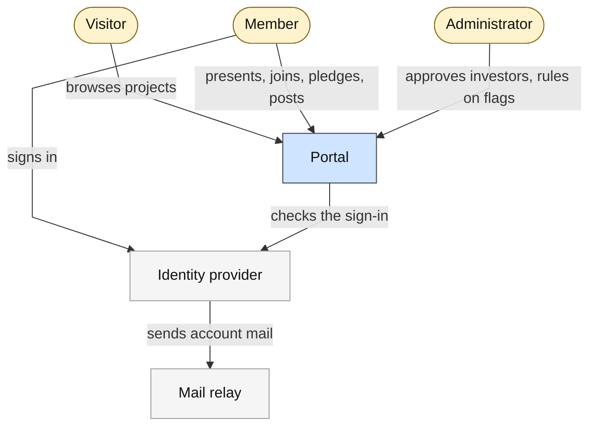

# Context and scope

The portal is one system reached through a browser. People sign in at an identity provider, and
the portal trusts the sign-in it hands back. Uploaded files sit in an object store that only the
portal reaches.

The identity provider is Keycloak, run by the project beside the portal
([identity provider](09-architecture-decisions/0004-identity-provider.md)), and it sends the mail
that confirms an address or recovers an account through Gmail's SMTP relay. The object store is
an Amazon S3 bucket ([data persistence](09-architecture-decisions/0003-data-persistence.md)).

## In scope

- Project pages, their content, files and stages, and the evidence a project shows when it goes live.
- Membership of a project as follower, contributor or investor.
- Pledges and the two funding totals, as they stand when a page is loaded.
- Forum threads per project.
- Investor verification by administrators, flags on live projects, rulings, and the reliability mark on an owner's account.
- Member profiles and roles, keyed by the identity the provider confirms.

## Out of scope

- Money and contracts. Members settle deals between themselves, away from the portal; the portal records only what an owner states was concluded.
- Credentials. Passwords, second factors and account recovery stay with the identity provider.
- Proof of identity. The identity provider confirms the e-mail address, and an administrator checks the phone number, real name and professional link by hand before approving an investor; the portal holds no identity document.
- Delivery of mail. The Gmail relay carries account mail to a member's inbox; the system runs no mail server and the portal sends no mail of its own.
- Text messages. The system sends none and includes no SMS delivery service; a phone number is checked by an administrator by hand.

## Trust boundaries

| Boundary | What crosses it | How it is guarded |
|---|---|---|
| Browser to portal, over the internet | the Web client's files, JSON requests and their answers, uploaded files | TLS at the reverse proxy; every input validated at the API block; authorisation checked per request on the server ([authentication and authorisation](08-crosscutting-concepts/authentication-and-authorisation.md), [input validation](08-crosscutting-concepts/input-validation.md)) |
| Browser to identity provider | the member's credentials and second factor | the portal never sees them; the provider's pages are served under TLS through the same proxy |
| Portal to identity provider | authorisation codes and signed tokens | tokens checked for signature, issuer, audience and expiry before a session is opened |
| Portal to object store | file contents and their generated names | a private bucket reached with the host's instance role; no browser reaches it directly |
| Identity provider to mail relay | a member's e-mail address and the confirmation or recovery link sent to it | SMTP with TLS, signed in with a credential kept as a secret file ([secrets](08-crosscutting-concepts/secrets.md)) |
| Member to administrator functions | investor approvals, flag rulings, reliability marks | administrator role required on the server for every such action, with a second factor at sign-in |
