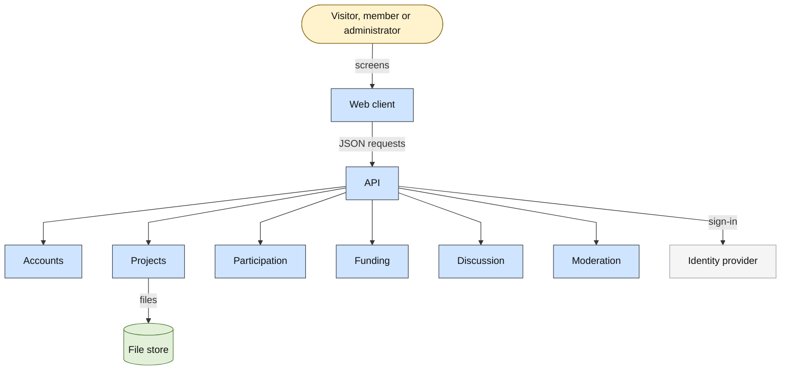

# Building block view

## Portal

The portal is a Web client in the browser and one application of six domain modules behind an
API block. Each module is a capability with its own tables and a public interface; the API block
turns the Web client's requests into calls on those interfaces and answers with JSON, and the Web
client shows the answers as screens.

The cut follows the parts of the product a member would name: the people, the projects, who
joined them, the money promised to them, the talk about them and the oversight of them. Each
changes for its own reasons, so each can be specified and built without reopening the others.
A module uses only modules earlier in the order Accounts, Projects, Participation; Funding,
Discussion and Moderation come last and use none of each other, so no cycle can form. Every module keeps its tables in a
PostgreSQL schema of its own ([data persistence](09-architecture-decisions/0003-data-persistence.md)).

### Web client

Responsible for what the member sees and does in the browser: the screens, the navigation between
them, and the forms that send a change. It holds no business rule and no token; every figure it
shows is what the API answered when the screen loaded.

- Offers: the portal's screens, in desktop and phone browsers.
- Uses: the API.

### API

Responsible for everything that faces the Web client: the HTTP routes, the shape of each request
and answer, the signed-in session and the sign-in with the identity provider, and the mapping of
every error to a problem response. It decides nothing about the domain; it asks the modules and
returns what they answer.

- Offers: JSON over HTTPS, described by an OpenAPI document; the sign-in and sign-out of a member.
- Uses: every module's public interface; the identity provider for sign-in.

### Accounts

Responsible for the members of the portal: each member's profile, keyed by the identity the
provider confirms, the roles a member holds on the platform, and the state of an investor's
verification with the administrator's approval of it.

- Offers: who a member is, which platform roles they hold, and whether they are a verified investor.
- Uses: no other module.

### Projects

Responsible for project pages: their content and customisation, the files attached to them, the
stages with their status and expected dates, and the evidence a live project shows.

- Offers: a project, its owner, its stage, and its files.
- Uses: Accounts; the file store for file contents.

### Participation

Responsible for who has joined a project and in which role, follower, contributor or investor,
and for what a contributor offers to do.

- Offers: whether a member has joined a project, and in which role.
- Uses: Accounts, Projects.

### Funding

Responsible for pledges on a project through their whole life up to conclusion, and for the two
totals derived from them, pledged and concluded.

- Offers: a project's totals; a project's individual pledges, to its owner.
- Uses: Accounts, Projects, Participation.

### Discussion

Responsible for each project's forum: its topics, their threads and the posts in them, kept in
order so the whole history stays readable.

- Offers: a project's topics and threads; posting, for members the policy allows.
- Uses: Accounts, Projects, Participation.

### Moderation

Responsible for oversight of live projects: flags raised against a project's evidence, the
administrator's ruling on each, and the reliability mark a ruling puts on an owner's account.

- Offers: the open flags; a ruling; whether an account carries the reliability mark.
- Uses: Accounts, Projects.
