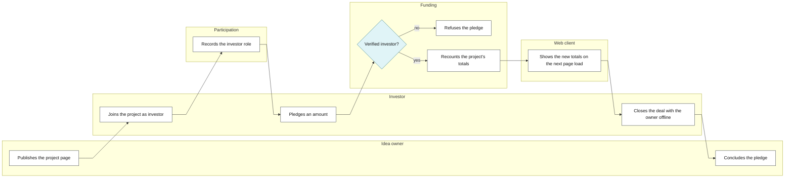

# Runtime view

## Main flow: a project is funded

An owner publishes a project, an investor joins it and pledges, and the project's totals show the
pledge the next time a page of the project is loaded. The deal itself is closed away from the
portal; the owner then records it as concluded.

Concluding a pledge runs through Funding the same way a new pledge does: Funding recounts, and
the concluded total shows on each page of the project the next time it is loaded. Nothing is
pushed to a page that is already open; a viewer reloads it to see a change.
