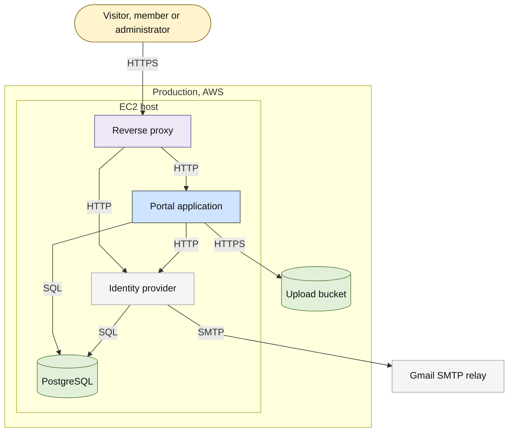

# Deployment view

## Production

Production is one EC2 host in one AWS region, running every instance as a container declared in
one compose file, an S3 bucket beside it, and Gmail's SMTP relay outside AWS
([production hosting](09-architecture-decisions/0005-production-hosting.md)).

| Instance | Kind | Where it runs | How many | Building blocks |
|---|---|---|---|---|
| EC2 host | virtual machine, 2 vCPU and 4 GB memory, with an encrypted disk for the database's data | one availability zone | 1 | hosts every container below |
| Reverse proxy | Caddy, the one listener on the internet; terminates TLS with a certificate it renews itself, serves the Web client's built files, and routes API requests to the application and sign-in pages to the identity provider, all on the portal's one domain | container on the host, its image carrying the Web client's built files | 1 | Web client, whose files it serves to the browser |
| Portal application | application service, Python and FastAPI | container on the host | 1 | API, Accounts, Projects, Participation, Funding, Discussion, Moderation |
| Identity provider | Keycloak, third-party product run by the project | container on the host | 1 | none |
| PostgreSQL | database server holding the portal's database and the identity provider's, each separate | container on the host, data on the host's disk | 1 | data of every module |
| Upload bucket | S3 bucket, private, encrypted at rest | AWS, same region | 1 | file contents for Projects |
| Gmail SMTP relay | third-party mail service that delivers the identity provider's account mail, reached over SMTP with TLS | Google | 1 account | none |
| Host network | an Elastic IP the portal's domain points at; a security group open on ports 80 and 443 to all, and on SSH to named administrator addresses only; an instance role attached to the host, the system's one IAM grant, giving the host's containers access to the upload bucket and nothing else; how these and the host come to exist is [GAP-0002](08-crosscutting-concepts/delivery.md) (release script and AWS resources not built) | AWS | 1 | none |

## Staging

No staging environment runs. Production is the system's one environment, and a release reaches it
when an administrator's release script builds the containers on the host from a tagged commit of
the product repo ([delivery](08-crosscutting-concepts/delivery.md)).
