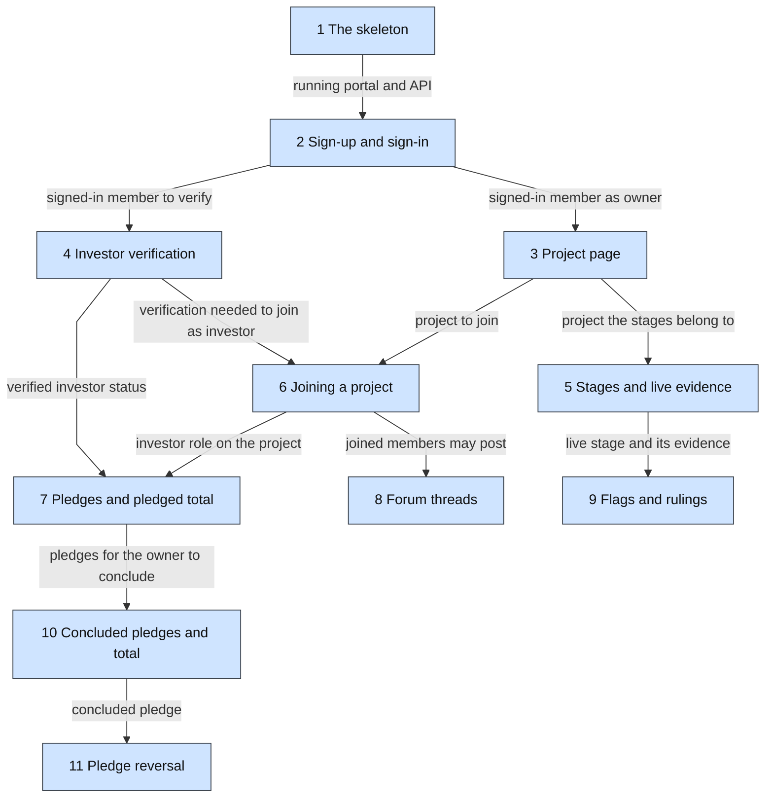

# Roadmap

## Destination

Anyone can sign up and present a project on a public web portal, where the owner tracks the status and ETA of each stage, signed-out visitors see the projects and their stages, members join it as followers, contributors or verified investors, the pledged and concluded funding show live beside the ask, the talk about it runs in its forum, and a live project shows evidence that members can flag for an administrator, whose unreliable mark stays on the owner's account until the administrator clears it.

## Steps

| # | Step | Source | Size | Route | Route reason | Status |
|---|---|---|---|---|---|---|
| 1 | The skeleton | [Building block view, Portal](../arch/05-building-block-view.md#portal): the Web client, the API and the six modules as an empty, running portal | — | | | delivered |
| 2 | Members sign up, sign in and set the name other members see | [Problem](../intents/0001-build-a-portal/idea-brief.md#problem): an open public community where anyone can sign up; [Users](../intents/0001-build-a-portal/idea-brief.md#users): the owner sees who joined, which needs a name to show | S | quick | S: one group, members signing up | idea |
| 3 | Owners publish a project page that visitors find in a plain list | [Outcome](../intents/0001-build-a-portal/idea-brief.md#outcome): a page with a description, photos, a slide deck and the investment needed, customised by its owner; [Users](../intents/0001-build-a-portal/idea-brief.md#users) and [Out of scope](../intents/0001-build-a-portal/idea-brief.md#out-of-scope): signed-out visitors see the projects, as a plain list | M | standard | M: affects owners, signed-in members and signed-out visitors | idea |
| 4 | Investors get verified by an administrator | [Users](../intents/0001-build-a-portal/idea-brief.md#users): light verification, an administrator approving the member's contact details, real name and professional link, with no identity documents kept | M | standard | M: affects investors and administrators | idea |
| 5 | Owners move a project through its stages, with evidence when it goes live | [Outcome](../intents/0001-build-a-portal/idea-brief.md#outcome): the status and ETA of each stage, idea to live, and the evidence a live project shows; [Users](../intents/0001-build-a-portal/idea-brief.md#users): signed-out visitors see the stages | M | standard | M: affects owners, signed-in members and signed-out visitors | idea |
| 6 | Members join a project as follower, contributor or investor | [Outcome](../intents/0001-build-a-portal/idea-brief.md#outcome): joining in a role, a contributor stating how they can help, the owner seeing who joined in which role | M | standard | M: affects followers, contributors, investors and owners | idea |
| 7 | Verified investors pledge, and the pledged total shows live | [Outcome](../intents/0001-build-a-portal/idea-brief.md#outcome): pledging, editing and withdrawing a pledge, the pledged total live; [Users](../intents/0001-build-a-portal/idea-brief.md#users) and [Constraints](../intents/0001-build-a-portal/idea-brief.md#constraints): individual amounts seen only by the owner | M | standard | M: affects investors, owners and signed-in members | idea |
| 8 | Joined members discuss a project in forum threads | [Outcome](../intents/0001-build-a-portal/idea-brief.md#outcome): topics and threads on each project, posted in only by members who joined it; [Users](../intents/0001-build-a-portal/idea-brief.md#users): hidden from signed-out visitors | M | standard | M: affects joined members, owners and signed-out visitors | idea |
| 9 | Members flag a live project, and an administrator rules on it and clears the mark | [Outcome](../intents/0001-build-a-portal/idea-brief.md#outcome): a flag reviewed against the live evidence, and the unreliable mark everyone sees on the owner's account until the matter is resolved; [Clearing the unreliable mark](sources/originator-decisions-2026-11-18.md#clearing-the-unreliable-mark): the Originator's answer that an administrator clears the mark once they judge the matter resolved | M | standard | M: affects members, owners and administrators | idea |
| 10 | Owners conclude or reject pledges, and the concluded total shows beside the pledged one | [Outcome](../intents/0001-build-a-portal/idea-brief.md#outcome): the owner concluding a pledge or rejecting one whose terms they do not agree to, and the two totals side by side | M | standard | M: affects owners, investors and signed-in members | idea |
| 11 | Reversing a concluded pledge through customer support | [Outcome](../intents/0001-build-a-portal/idea-brief.md#outcome): a reversal of a concluded pledge goes through customer support as a contract rollback | fog | | | idea |

## Not yet specified

| Area | What would have to be learned | Blocks | How it gets sharpened |
|---|---|---|---|
| Reversing a concluded pledge (step 11) | Who customer support is on a portal whose only staff role is the administrator, who asks for a reversal, what a contract rollback changes on the portal, whether the pledge returns to pledged or disappears, how the concluded total moves, and who is told | No step; it follows step 10 | An intent with the Originator on the rollback, citing what step 10 delivered |

## Out of scope

- Moving money or handling contracts through the platform ([Out of scope](../intents/0001-build-a-portal/idea-brief.md#out-of-scope)).
- Private messages between members ([Out of scope](../intents/0001-build-a-portal/idea-brief.md#out-of-scope)).
- Native mobile apps ([Out of scope](../intents/0001-build-a-portal/idea-brief.md#out-of-scope)).
- Matching or recommending investors to projects ([Out of scope](../intents/0001-build-a-portal/idea-brief.md#out-of-scope)).
- Search and browsing beyond a plain list of projects ([Out of scope](../intents/0001-build-a-portal/idea-brief.md#out-of-scope)).
- Interface languages other than English ([Constraints](../intents/0001-build-a-portal/idea-brief.md#constraints)).

## Dependency graph

## Execution path

| Wave | Steps | Zones | Unlocks |
|---|---|---|---|
| 1 | 1 | 1: Web client, API, Accounts, Projects, Participation, Funding, Discussion, Moderation | Every step, on a portal that builds and runs |
| 2 | 2 | 2: Accounts | Signed-in members, for project pages and investor verification |
| 3 | 3, 4 | 3: Projects; 4: Accounts | Projects to stage and join; verified investors to join as investors and pledge |
| 4 | 5, 6 | 5: Projects; 6: Participation | Live projects to flag; joined members for pledges and the forum |
| 5 | 7, 8, 9 | 7: Funding; 8: Discussion; 9: Moderation | Pledges for the owner to conclude; the pilot's measure, a live project with no upheld flag |
| 6 | 10 | 10: Funding | Concluded pledges, which step 11 acts on once the area under Not yet specified is settled and the step is sized |
