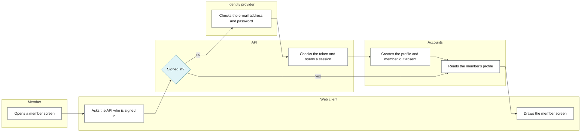

# Sign in to the portal

## Scope

This spec is the walking skeleton of
[PRD 0001](../../prd/0001-members-sign-up-sign-in-and-set-the-name-other-members-see.md)
(member accounts and display names), for [step 2](../../roadmap/roadmap.md#steps) (accounts
and the name others see). A member signs in at the identity provider, the
API block opens a portal session, Accounts creates the member's profile and member id at the
first sign-in, and the member reaches a member screen inside the member layout.
It builds two parts of the tree that the running system does not carry yet, the portal session of
the [account pages](../../arch/08-crosscutting-concepts/authentication-and-authorisation.md#account-pages)
concept and the member id of the Profile class in
[data classification](../../arch/08-crosscutting-concepts/data-classification.md); the
[architecture leg's record](../../arch/_runs/0001-members-sign-up-sign-in-and-set-the-name-other-members-see.md#escalations)
(the decision to build them with this PRD's specs) holds why. It clears no
entry under [Technical debt](../../arch/11-risks-and-technical-debt.md#technical-debt), which
registers none.

In scope:

- The API block as the OpenID Connect client: sign-in, the callback, sessions in PostgreSQL, the
  state-change token, and the request filter's checks of the session and the token.
- Accounts' first table: the profile with its member id, created at the first sign-in and read
  through the module's interface.
- The Web client's API client and the member layout.
- The portal's public client in the identity provider's realm import.

Out of scope:

- The provider's themed account pages, the sign-up form and its template override, address
  confirmation, recovery and their messages, which
  [PRD 0001, requirements 1, 2, 3 and 8](../../prd/0001-members-sign-up-sign-in-and-set-the-name-other-members-see.md#requirements)
  (sign-up, confirmation, sign-in, recovery) ask for: another spec of this PRD. Here a member
  signs in on the provider's login page as the realm serves it.
- The display-name prompt, the display-name rule, saving a name, and the request filter's hold on
  a member who has no display name:
  [spec 0005](../0005-choose-a-display-name/0005-choose-a-display-name.md) (choose a display
  name).
- Sign-out and the header's Sign out link,
  [requirement 4](../../prd/0001-members-sign-up-sign-in-and-set-the-name-other-members-see.md#requirements)
  (sign-out).
- Your account in its default state, with the display name in the header and the member id:
  [spec 0004](../0004-your-account-and-the-member-id/0004-your-account-and-the-member-id.md)
  (your account and the member id).
- Changing the name on Your account: the Display name section of
  [SCR-4](../../ui/0001-members-sign-up-sign-in-and-set-the-name-other-members-see/screens.md#scr-4-your-account)
  (your account) with its field, save, validation and success states,
  [requirement 6](../../prd/0001-members-sign-up-sign-in-and-set-the-name-other-members-see.md#requirements)
  (changing the display name).
- Showing a display name or member id to other members, and the public page at `/`, which stays as
  the skeleton left it.

## Approach

The API block is the OpenID Connect client and the session holder the
[sign-in](../../arch/08-crosscutting-concepts/authentication-and-authorisation.md#sign-in)
concept describes, and signs the member in with Authlib over httpx, the client the Originator
chose over PyJWT with a hand-written code exchange and over python-keycloak. On every API request
it resolves the session and checks the state-change token on writes. At a member's first sign-in
it has [Accounts](../../arch/05-building-block-view.md#accounts) (the members' profiles) create the
profile and its member id. The Web client asks who is signed in before it draws a member screen,
and either sends the browser to sign in or draws the screen.

Three blocks of the [building block view](../../arch/05-building-block-view.md) change: the
[API](../../arch/05-building-block-view.md#api) gains the routes, the session store and the
filter below; [Accounts](../../arch/05-building-block-view.md#accounts) gains its schema and the
operations that create and read a profile; the
[Web client](../../arch/05-building-block-view.md#web-client) gains its API client and the member
layout. The flow follows [ADR 0004](../../arch/09-architecture-decisions/0004-identity-provider.md) (identity
provider), and writes to the [persistence](../../arch/08-crosscutting-concepts/persistence.md)
concept.

### Sign-in and the session

- `GET /api/sign-in?return=<path>` keeps the return path when it is portal-relative: it starts
  with one `/` followed by neither `/` nor `\`, and does not start with `/api/`, `/realms/` or
  `/resources/`. Any other value
  becomes `/account`, Your account. The route stores a sign-in attempt holding a random state, a
  nonce, a PKCE verifier and the return path, valid for 30 minutes, sets a `__Host-portal-sign-in`
  cookie carrying the state for the same time, and redirects to the provider's authorisation
  endpoint with PKCE S256 and the scope `openid` alone.
- `GET /api/sign-in/callback` accepts the response only when its state equals the cookie's and
  names a live attempt, and deletes the attempt so it is used once. It exchanges the code with the
  PKCE verifier over the private network, with no client secret, and Authlib checks the ID token's
  signature against the provider's keys, its issuer (the provider's public URL), its audience (the
  portal's client), its expiry and its nonce. The API block then ends any session the browser's
  cookie names, calls Accounts to ensure the member's profile for the token's subject, opens a new
  session, clears the sign-in cookie and redirects to the return path.
- A session id is 32 bytes from Python's `secrets`, sent in the cookie `__Host-portal-session`
  with the attributes the sign-in concept sets and no expiry of its own, and stored only as its
  SHA-256 hash. The row holds the subject, the state-change token (32 bytes from `secrets`), the
  creation time and the last-seen time. A session ends 30 minutes after its last request or 10
  hours after it opened; the last-seen time is written at most once a minute; an ended session
  counts as none and its row is deleted when met. Creating a session also deletes ended sessions
  and expired attempts. The sessions and the sign-in attempts are tables in the schema `accounts`,
  beside the profile.
- `GET /api/session` answers the session's state-change token, with `Cache-Control: no-store`.
  Every `POST`, `PUT`, `PATCH` and `DELETE` under `/api` carries it in `X-State-Token`, and the
  API block compares it in constant time, and the `Origin` header with the portal's public origin,
  before any route runs.
- The provider's metadata and keys are fetched from its private URL with a 5-second timeout and
  cached in the process; the keys are fetched again once when a token names an unknown key.
  Settings name the portal's public URL, the provider's public and private URLs and the client id.
- The realm import declares the portal's client as a public client: it holds no secret, requires
  PKCE with S256, and registers the callback as its redirect URI in each environment. Its default
  client scopes are listed as `basic` alone. `basic` carries the `sub` claim, the subject the
  profile lookup reads and sign-out's ID token hint relies on; an ID token without it has no subject.
  The list leaves out `email` and `profile`, because Keycloak adds a client's default scopes to
  its tokens whatever scope the request names, and the `profile` scope carries the username, here
  the member's e-mail address.

### Profile and member id

Accounts' tables sit in the schema `accounts`. One table holds the profile: an id PostgreSQL
generates, the provider's subject (unique), the member id (unique), the display name (empty until
set), a version, and the times it was created and changed. The version is there because the
[persistence](../../arch/08-crosscutting-concepts/persistence.md) concept requires one on a table
two writers update, as [ADR 0003](../../arch/09-architecture-decisions/0003-data-persistence.md#costs)
(data persistence) accepts the cost of: the profile gets the display-name save of
[spec 0005](../0005-choose-a-display-name/0005-choose-a-display-name.md) (choose a display name),
which checks it, and later an investor's verification state. The API block passes Accounts the
subject and nothing else from the token, so the portal stores no e-mail address.

A member id is `M-` followed by 8 characters of Crockford base32 (the digits and the capitals
without I, L, O and U) drawn from `secrets`, so it is derived from nothing the account holds. A
draw that collides with an existing id is drawn again, up to five times. Ensuring a profile inserts
it and does nothing where the subject already has one, then reads it, so two first sign-ins at
once create one profile. A profile is complete when its display name is set.

Accounts' interface has two operations here: ensure the profile of a subject; and read a member,
giving the display name or none, the member id and whether the profile is complete.

### The request filter

Every route under `/api` except health, `GET /api/sign-in` and the callback runs two checks in
order:

1. No live session: 401 problem response of type `signed-out`.
2. A write without a matching state-change token or with a foreign origin: 403 of type
   `state-token-invalid`, and nothing changes.

The route this spec adds behind the filter is `GET /api/members/me`, answering `displayName`, empty
until the member sets one, and `memberId`, with `Cache-Control: no-store`.

### The Web client

One API client makes every call on the portal's origin. It fetches the state-change token once
per page load and sends it on every write. On a 401 it sends the browser to
`/api/sign-in?return=` with the current path; any other problem becomes a readable message with
the correlation id. The API types are regenerated from the OpenAPI document.

`/account`, Your account, sits inside a member layout whose header carries the wordmark; the
page's content and the display name in the header are
[spec 0004](../0004-your-account-and-the-member-id/0004-your-account-and-the-member-id.md#your-account)'s
(your account and the member id). The layout reads `GET /api/members/me` before
it draws anything about the member. Vue's escaping shows every value the API answers; no template
uses `v-html`.

### Failure paths

| Case | What the system does | What the member sees |
|---|---|---|
| Signed out, or the session ended | 401 from the filter | the provider's sign-in page, then the screen they opened |
| Callback state missing from the cookie, foreign or expired | no session; with a sign-in cookie present, a fresh sign-in starts for `/account`; without one, a 400 problem response | a second pass through sign-in, or the message to open the portal again |
| ID token fails a check | no session, a security event logged, 400 problem response | the message to open the portal again |
| Provider unreachable or slower than 5 seconds | no session, 503 problem response; open sessions keep working | sign-in is unavailable, try again shortly |
| Two first sign-ins at once | one profile with one member id, both sessions open | the same member in both tabs |
| Write without the token, or from a foreign origin | 403, nothing changed | the generic message with the correlation id |

Sign-in and its failures, a refused state-change token and a refused callback are security events
in the [logging](../../arch/08-crosscutting-concepts/logging.md) concept, carrying the member id
where one is known. No log line carries a token, a code, a state or a session id.

### Tests and local stand-ins

- Unit, pytest with no database: the member id's format and
  alphabet; the return-path check; the filter's two answers and the token comparison through
  FastAPI's test client, with Accounts and the session store faked behind their interfaces; the
  callback against a recorded provider exchange whose token is signed by a test key, refused for a
  wrong issuer, audience, expiry, nonce or signature. Vitest: the API client's 401 handling and
  its readable message, and the layout drawing nothing about the member before the read answers.
- Integration, pytest under `tests/integration` against the compose stack's PostgreSQL after
  `alembic upgrade head`: unique member ids, two concurrent first sign-ins creating one profile,
  and session expiry. A developer runs them with the database
  service up, as the skeleton's migration check is run.
- Functional, stage 05's, through `scripts/functional.sh`: the real Keycloak with the realm import,
  confirmed test members created through its admin interface by the tests' setup, each given a
  first and a last name so the provider's default user profile asks nothing more at sign-in,
  Playwright in Chromium.

Three things are risky. The application calls Keycloak on the private network while the browser
uses the public URL, so Keycloak runs with a dynamic back-channel hostname and the issuer is
checked against the public URL. The `__Host-` cookies need a secure context, which Chromium grants
`http://localhost` on the local stack. Keycloak imports the realm only when it does not exist, so
a local stack started before this spec is recreated with its volumes.

### Rollout

No flag: nothing is reachable as a member before this spec. It goes out in one release with
[spec 0005](../0005-choose-a-display-name/0005-choose-a-display-name.md) (choose a display name),
since on its own it lets a member with no display name reach member screens. One Alembic revision creates the
schema `accounts` with its tables, applied before the new version takes traffic; its
downgrade drops them, and after launch a rollback runs the previous version and leaves the tables
in place. Outside the code, the release needs the portal client, with its default client scopes,
added to a production realm that already exists, through the provider's admin console with the
import's settings; the back-channel hostname option; and the new settings. No secret is added.
Authlib and httpx become runtime dependencies.

## Acceptance criteria answered

### [Member accounts and display names](../../prd/0001-members-sign-up-sign-in-and-set-the-name-other-members-see.md)

The step's PRD: accounts, sign-in and the display name.

- [`AC-0001-4`](../../prd/0001-members-sign-up-sign-in-and-set-the-name-other-members-see.md#acceptance-criteria):
  "Given a confirmed account, When its holder signs in with the right e-mail address and password,
  Then they are signed in." Answered in [Sign-in and the session](#sign-in-and-the-session).

## Screens

No screen.

## Interfaces

[contracts/openapi.yaml](contracts/openapi.yaml)

## Data

[data-model.md](data-model.md)

## Security

- **Browser to API.** A new trust boundary carried by the session cookie, the state-change token
  and the origin check, as the [sign-in](../../arch/08-crosscutting-concepts/authentication-and-authorisation.md#sign-in)
  and [who may do what](../../arch/08-crosscutting-concepts/authentication-and-authorisation.md#who-may-do-what)
  concepts place them. Refused: a request with no live session, which
  [AC-0001-12](../../prd/0001-members-sign-up-sign-in-and-set-the-name-other-members-see.md#acceptance-criteria)
  (a visitor sent to sign in) states; a write without the token or from another origin, which
  the PRD states no criterion for and the unit tests prove.
- **API to identity provider.** The back channel on the private network. The portal's client is
  public and holds no secret: the PKCE verifier, which never leaves the API block, binds the code
  exchange to the browser that started the sign-in. Refused: a callback whose
  state is foreign, expired or reused, and an ID token with a wrong signature, issuer, audience,
  expiry or nonce; each opens no session, and the unit tests prove each refusal.
- **Data.** The display name and member id are the Profile class, held in Accounts alone, as
  [data classification](../../arch/08-crosscutting-concepts/data-classification.md) places them.
  The portal client asks for `openid` alone and its default client scopes leave out `email` and
  `profile`, so no token the API block receives holds the address, and the member id is random,
  which
  [AC-0001-9](../../prd/0001-members-sign-up-sign-in-and-set-the-name-other-members-see.md#acceptance-criteria)
  (shared names keep different ids) checks. Session ids are stored as hashes; state-change tokens,
  PKCE verifiers and codes never reach a log line.
- **Accepted gap.** The [input validation](../../arch/08-crosscutting-concepts/input-validation.md)
  concept bounds the rate of sign-in per client, and this spec builds no such limit. A client can
  call `GET /api/sign-in` at any rate, and each call stores a sign-in attempt that stays until it
  expires or the next session's creation deletes it.
