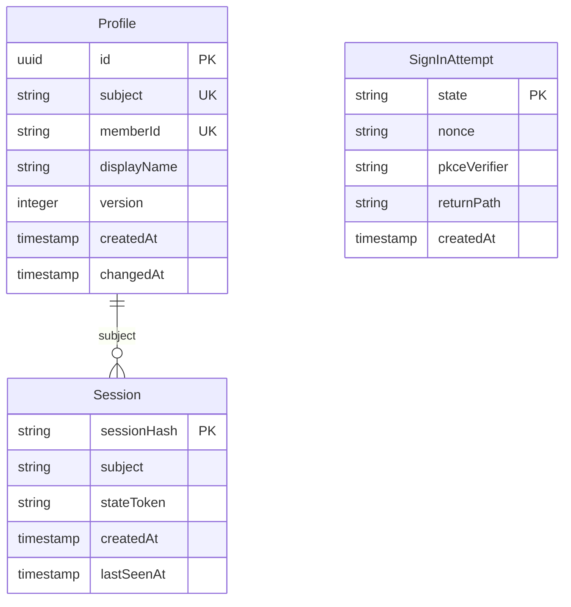

# Data model: Sign in to the portal

Derived from [Sign in to the portal](0001-sign-in-to-the-portal-and-choose-a-display-name.md).
The three tables sit in the PostgreSQL schema `accounts`, as the spec's Approach places them.

## Entities

### Profile

new; owned by [Accounts](../../arch/05-building-block-view.md#accounts)

| Field | Type | Required | Constraints | Meaning |
|---|---|---|---|---|
| id | uuid | yes | primary key, generated by PostgreSQL | "an id PostgreSQL generates" |
| subject | string | yes | unique | the provider's subject, the identity the member signs in with |
| memberId | string, `M-` plus 8 characters of Crockford base32 | yes | unique, drawn from `secrets`, redrawn up to five times on a collision | the member id Accounts generates at the first sign-in; stored in column `member_id` |
| displayName | string | yes | empty until set | the display name other members see, column `display_name`; set by [spec 0005](../0005-choose-a-display-name/0005-choose-a-display-name.md) (choose a display name), empty here |
| version | integer | yes | checked on update | "a version" the persistence concept requires on a table two writers update |
| createdAt | timestamp UTC | yes | | derived: "the times it was created and changed"; column `created_at` |
| changedAt | timestamp UTC | yes | | derived: "the times it was created and changed"; the time of the last change, column `changed_at` |

### Session

new; owned by [API](../../arch/05-building-block-view.md#api), stored in the schema `accounts`

| Field | Type | Required | Constraints | Meaning |
|---|---|---|---|---|
| sessionHash | string, 64 characters, lower-case hex of the SHA-256 hash | yes | primary key | derived: "stored only as its SHA-256 hash"; the session id itself is never stored; column `session_hash` |
| subject | string | yes | | the provider's subject of the signed-in member |
| stateToken | string (32 random bytes) | yes | | the state-change token answered by `GET /api/session`; column `state_token` |
| createdAt | timestamp UTC | yes | | derived: "the creation time"; the session ends 10 hours after it; column `created_at` |
| lastSeenAt | timestamp UTC | yes | written at most once a minute | derived: "the last-seen time"; the session ends 30 minutes after it; column `last_seen_at` |

### SignInAttempt

new; owned by [API](../../arch/05-building-block-view.md#api), stored in the schema `accounts`

| Field | Type | Required | Constraints | Meaning |
|---|---|---|---|---|
| state | string (random) | yes | primary key | derived: the callback "names a live attempt" by the state its response carries |
| nonce | string | yes | | checked against the ID token's nonce |
| pkceVerifier | string | yes | | the PKCE verifier, which never leaves the API block; column `pkce_verifier` |
| returnPath | string | yes | portal-relative; `/account` where the requested value fails the check | derived: "the return path"; the path the browser is redirected to after sign-in; column `return_path` |
| createdAt | timestamp UTC | yes | | derived: "valid for 30 minutes"; the expiry is 30 minutes after it; column `created_at` |

## Relationships

- Profile to Session: one profile, none or many sessions, joined on `subject`. The spec declares
  no foreign key, and states no deletion of a profile, so no delete behaviour is derived.
- SignInAttempt stands alone: no relationship to another entity.

## Identifiers and uniqueness

| Entity | Identifier | Unique |
|---|---|---|
| Profile | `id` | `subject` and `memberId`, each across the table |
| Session | `sessionHash` | the hash, across the table |
| SignInAttempt | `state` | the state, across the table, so an attempt is used once |

## Indexes

| Entity | Fields | Query that needs it |
|---|---|---|
| Profile | `subject`, unique | ensuring a profile for the token's subject, and reading a member's profile |
| Profile | `memberId`, unique | a drawn member id colliding with an existing one |
| Session | `sessionHash`, primary key | resolving the session the cookie names on every request |
| SignInAttempt | `state`, primary key | the callback finding its live attempt |

## Lifecycle

Profile:

| State | Transition | Trigger |
|---|---|---|
| incomplete (display name empty) | created | the member's first sign-in |
| complete (display name set) | incomplete to complete | a display name is set, by [spec 0005](../0005-choose-a-display-name/0005-choose-a-display-name.md) (choose a display name) |

Session:

| State | Transition | Trigger |
|---|---|---|
| live | opened | the callback accepts the ID token |
| ended | live to ended | idle for 30 minutes (`lastSeenAt`), or open for 10 hours (`createdAt`) |
| deleted | ended to deleted | the ended session is met, or a session is created |

SignInAttempt:

| State | Transition | Trigger |
|---|---|---|
| live | stored | `GET /api/sign-in` |
| used | live to deleted | the callback accepts the response |
| expired | live to deleted | 30 minutes pass, deleted when a session is created |

## Sensitive data

| Field | Class | Retention |
|---|---|---|
| Profile.memberId | Profile, per [data classification](../../arch/08-crosscutting-concepts/data-classification.md) | the spec states none |
| Profile.displayName | Profile, per data classification | the spec states none |
| Profile.subject | the identity key of the profile, held in Accounts; the table names no class for it | the spec states none |
| Session.sessionHash, Session.stateToken | session credentials, never in a log line; the table names no class for them | until the session ends |
| SignInAttempt.state, nonce, pkceVerifier | sign-in credentials, never in a log line; the table names no class for them | 30 minutes, or until the callback uses the attempt |

The portal stores no e-mail address: the API block passes Accounts the subject and nothing else.

## Diagram

