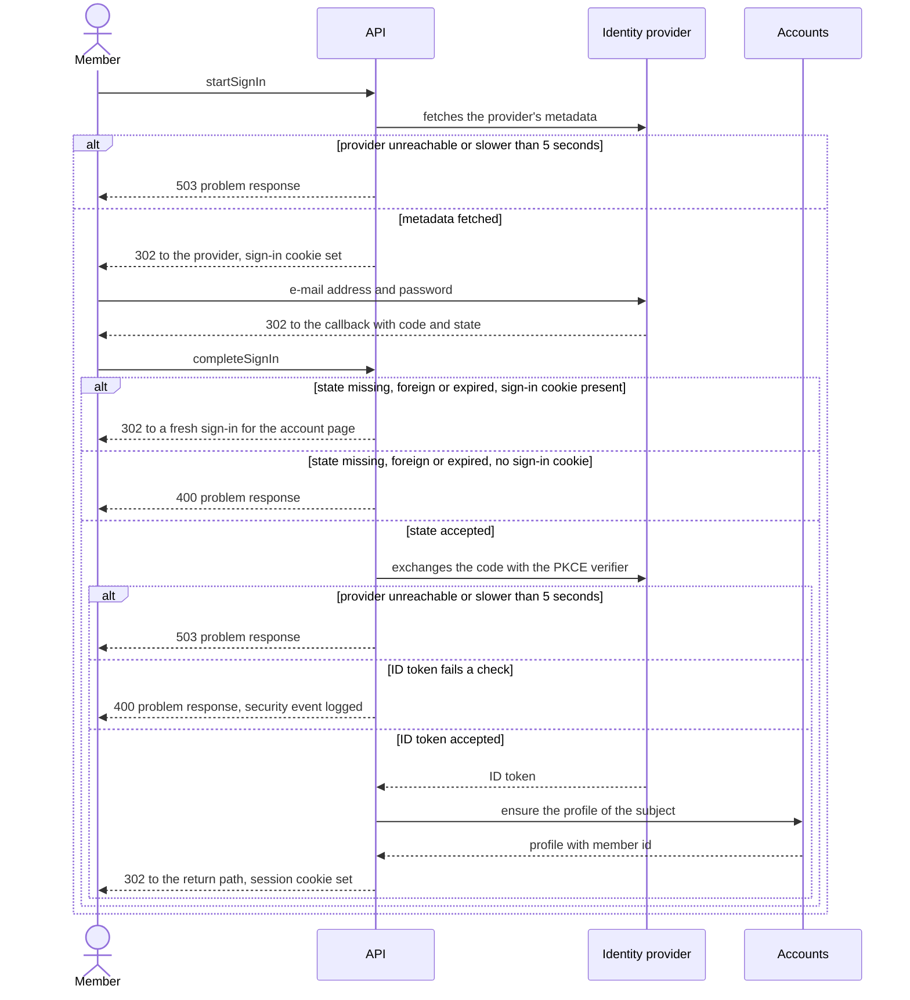
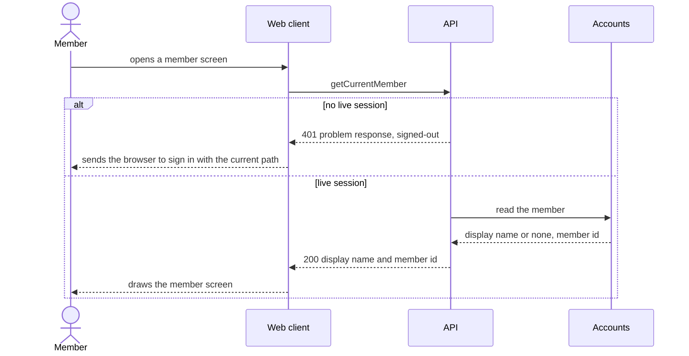
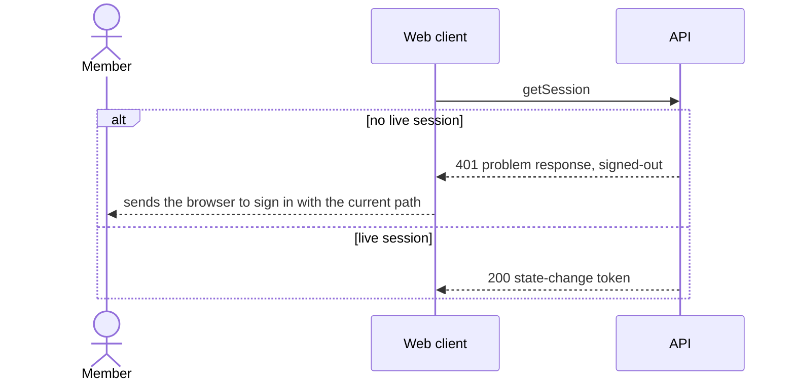

# Sequences: Sign in to the portal

Derived from [Sign in to the portal](0001-sign-in-to-the-portal-and-choose-a-display-name.md) and its [contracts/openapi.yaml](contracts/openapi.yaml).

## Flows

### Sign in at the identity provider

Started by the Member's browser, sent by the Web client on a 401 or following a link to the portal; serves [`AC-0001-4`](../../prd/0001-members-sign-up-sign-in-and-set-the-name-other-members-see.md#acceptance-criteria) (a confirmed account's holder signs in with the right e-mail address and password).

### Draw a member screen

Started by the Member opening a member screen; serves [`AC-0001-4`](../../prd/0001-members-sign-up-sign-in-and-set-the-name-other-members-see.md#acceptance-criteria) (a confirmed account's holder signs in).

### Fetch the state-change token

Started by the Web client once per page load; serves [`AC-0001-4`](../../prd/0001-members-sign-up-sign-in-and-set-the-name-other-members-see.md#acceptance-criteria) (a confirmed account's holder signs in). The member screen does not wait for it.

