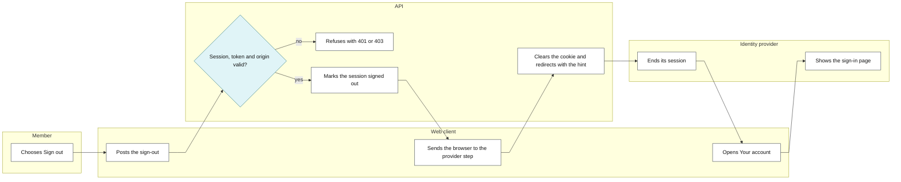

# Change the display name and sign out

## Scope

This spec builds the last two member actions of
[PRD 0001](../../prd/0001-members-sign-up-sign-in-and-set-the-name-other-members-see.md)
(member accounts and display names), for [step 2](../../roadmap/roadmap.md#steps) (accounts and
the name others see): a member changes their display name on Your account, and signs out from the
header. It extends what
[spec 0001](../0001-sign-in-to-the-portal-and-choose-a-display-name/0001-sign-in-to-the-portal-and-choose-a-display-name.md)
(sign in to the portal), called the sign-in spec below, builds: its session store and its request
filter. It extends what
[spec 0005](../0005-choose-a-display-name/0005-choose-a-display-name.md) (choose a display name)
builds: the display-name rule, the route and Accounts' operation that save a name, and the
filter's third check. It extends what
[spec 0004](../0004-your-account-and-the-member-id/0004-your-account-and-the-member-id.md)
(your account and the member id) builds as well: Your account in its default state and the
display name in the header. Sign-out follows the
[sign-in](../../arch/08-crosscutting-concepts/authentication-and-authorisation.md#sign-in) concept
(how a session starts and ends). It clears no entry under
[Technical debt](../../arch/11-risks-and-technical-debt.md#technical-debt), which registers none.

In scope:

- The Display name section of Your account in its validation and success states, saving through
  the route
  [spec 0005](../0005-choose-a-display-name/0005-choose-a-display-name.md#setting-the-name)
  (choose a display name) adds.
- The header's Sign out control and two sign-out routes in the API block.
- The session store keeping the ID token from sign-in and the time a session was signed out, with
  the migration for both.
- The request filter letting sign-out through while a profile is incomplete.
- The portal client's post-logout redirect URI in the identity provider's realm import.
- The [reverse proxy](../../arch/07-deployment-view.md#production)'s access log, configured in the
  product repo's `deploy/caddy/Caddyfile`, which removes the ID token from every line it writes
  for sign-out.

Out of scope:

- The display-name rule, the prompt, and the route and Accounts operation that save a name:
  [spec 0005](../0005-choose-a-display-name/0005-choose-a-display-name.md#the-display-name-rule)
  (choose a display name) builds them and this spec uses them unchanged.
- Signing a member out of their other browsers and devices: a sign-out ends the session of the
  browser it is made in, which is what
  [requirement 4](../../prd/0001-members-sign-up-sign-in-and-set-the-name-other-members-see.md#requirements)
  (sign-out) asks.
- The look of the provider's pages a member passes after signing out, which
  [spec 0002](../0002-account-pages-at-the-identity-provider/0002-account-pages-at-the-identity-provider.md)
  (account pages at the identity provider) builds.
- Showing a display name to other members, which the PRD leaves to later steps.

## Approach

Changing the name needs no new operation or route. The Display name section of Your account saves
through `PUT /api/members/me/display-name` and Accounts' set-the-display-name operation, both from
[spec 0005](../0005-choose-a-display-name/0005-choose-a-display-name.md#setting-the-name)
(choose a display name), so the prompt and the change apply one rule; this spec adds the Web client's half.
Sign-out is two requests to the API block. The Web client posts the sign-out with the state-change
token, and the API block marks the session signed out. The Web client then sends the browser to a
second route, which redirects it to the provider's end-session endpoint with the session's ID token
as the hint. The provider ends its own session without showing a page and returns the browser to
Your account, which now finds no session and leads to the sign-in page.

Two blocks of the [building block view](../../arch/05-building-block-view.md) change: the
[API](../../arch/05-building-block-view.md#api) gains the sign-out routes and two session columns,
and the [Web client](../../arch/05-building-block-view.md#web-client) gains the Display name
section and the Sign out control. This spec adds no operation to
[Accounts](../../arch/05-building-block-view.md#accounts), whose schema holds the session table: it calls the profile read of the
sign-in spec and the set operation of
[spec 0005](../0005-choose-a-display-name/0005-choose-a-display-name.md) (choose a display name).
The provider is Keycloak, as
[ADR 0004](../../arch/09-architecture-decisions/0004-identity-provider.md) (identity provider)
decides, and the session columns follow the
[persistence](../../arch/08-crosscutting-concepts/persistence.md) concept.

### Changing the display name

- The Display name section shows the field filled with the name the member layout reads from
  `GET /api/members/me`, and Save display name. The API client sends the field's value to
  `PUT /api/members/me/display-name` with the state-change token, and the button stays disabled
  while the request is out.
- A 422 draws the validation state of
  [SCR-4](../../ui/0001-members-sign-up-sign-in-and-set-the-name-other-members-see/screens.md#scr-4-your-account)
  (Your account) with the problem's message. The field keeps what the member typed, and the
  header keeps the saved name.
- A 200 draws the success state of the same entry with the name the answer carries, the trimmed
  and normalised value Accounts stored. The notice stays until the next save or the next page
  load.
- On a complete profile the route saves the name and keeps the session id; only the save that
  completes a profile issues a new one, as
  [spec 0005](../0005-choose-a-display-name/0005-choose-a-display-name.md#setting-the-name)
  (choose a display name) builds the route.
- The save meets Accounts' version check, which
  [spec 0005](../0005-choose-a-display-name/0005-choose-a-display-name.md#setting-the-name)
  (choose a display name) builds: where another write lands between the save's read and its
  update, the route answers 409 `profile-changed` and nothing is saved. No state of Your account's
  screen draws this answer; the table under Failure paths holds what the member sees. Two saves
  one after the other both pass the check, so the later one stands, and another open tab shows
  the old name until it reloads.

### Sign-out

- The member layout's header carries Sign out after the display name
  [spec 0004](../0004-your-account-and-the-member-id/0004-your-account-and-the-member-id.md#your-account)
  (your account and the member id) draws there, as a button drawn like the
  prototype's link, because it sends a `POST`. The prompt keeps its header without it, as
  [spec 0005](../0005-choose-a-display-name/0005-choose-a-display-name.md#the-prompt) (choose a
  display name) draws it.
- `POST /api/sign-out` takes no body and passes the filter's first two checks: a live session, then
  the state-change token and the portal's origin. It sets the session's signed-out time, logs a
  sign-out security event with the member id, and answers 204. It joins the display-name setup in
  the exception to the filter's third check, which
  [spec 0005](../0005-choose-a-display-name/0005-choose-a-display-name.md#the-request-filters-third-check)
  (choose a display name) adds, so a member whose profile is incomplete can still
  sign out through the API, as the
  [account pages](../../arch/08-crosscutting-concepts/authentication-and-authorisation.md#account-pages)
  concept allows.
- On 204 the Web client sets the browser's location to `/api/sign-out/provider`. A 401 takes the
  API client's usual path to sign in; any other problem shows the readable message with the
  correlation id.
- `GET /api/sign-out/provider` stands outside the filter, beside sign-in and the callback. Where
  the session cookie names a signed-out session, it clears the cookie and answers 303 to the
  end-session endpoint in the provider's metadata, with `id_token_hint` set to the session's ID
  token, `post_logout_redirect_uri` set to the portal's public URL followed by `/account`, and
  `client_id`. The end-session request authenticates no client, so the portal's public client,
  which holds no secret, signs out with these three parameters alone. Where the cookie names a
  live session or no session, or is absent, it answers 303
  to `/account`. It writes nothing on the server, so a repeat or a link from another site ends
  nothing.
- The provider checks the hint's signature, ends its session, clears its own cookies and
  redirects to the registered URI. Your account then gets a 401, and the Web client sends the
  browser to sign in through the 401 handling of the sign-in spec's
  [Web client](../0001-sign-in-to-the-portal-and-choose-a-display-name/0001-sign-in-to-the-portal-and-choose-a-display-name.md#the-web-client).

### The session store and the filter

- The callback stores the ID token, as the provider returned it, in the new session row. The row
  keeps it when completing the profile issues a new session id, which
  [spec 0005](../0005-choose-a-display-name/0005-choose-a-display-name.md#setting-the-name)
  (choose a display name) builds.
- A session with a signed-out time counts as none on every route. Unlike an ended session, its row
  stays in place when met, so the provider step can still read it; the cleanup that runs when a
  session is created deletes signed-out rows marked more than 5 minutes earlier, with the ended
  ones.
- The ID token and the signed-out time are two new nullable columns of the session table in the
  `accounts` schema; no other table changes.
- The stored token carries no contact data: the portal client asks for `openid` alone, and its
  default client scopes leave out `email` and `profile`, as the sign-in spec's
  [sign-in and the session](../0001-sign-in-to-the-portal-and-choose-a-display-name/0001-sign-in-to-the-portal-and-choose-a-display-name.md#sign-in-and-the-session)
  declares the client.
- The realm import registers the post-logout redirect URI on the portal client, one per
  environment, the same way it registers the sign-in redirect URI.

### Alternatives considered

- Ending the provider's session with the client id alone stores no token, and the provider then
  shows its own confirmation page between Sign out and the sign-in page, a page the
  [screen flow](../../ui/0001-members-sign-up-sign-in-and-set-the-name-other-members-see/screens.md#flow)
  does not have.
- Ending it from the API block with the refresh token takes one request, and keeps a credential
  in the portal's database, where the
  [data classification](../../arch/08-crosscutting-concepts/data-classification.md) keeps
  credentials at the provider only.
- Answering the end-session address to the Web client saves the second route, and puts the ID
  token in the Web client's hands, which the sign-in concept forbids.

### Failure paths

| Case | What the system does | What the member sees |
|---|---|---|
| A name outside the rule | 422, nothing saved | the validation state |
| The session ended before Save or Sign out | 401 from the filter | the sign-in page, then Your account |
| A save or sign-out missing the state-change token, or sent from another origin | 403, and the session and the name stay as they were | the readable message any refused write gets, with its correlation id |
| A save meeting the version check of [spec 0005](../0005-choose-a-display-name/0005-choose-a-display-name.md#setting-the-name) (choose a display name) after another write came first | 409 `profile-changed`, nothing saved | the API client's readable message with its correlation id, the field keeping what they typed and the header the saved name; no state of Your account's screen draws it |
| The provider step opened by a link from another site, or a second time | 303 to `/account`, nothing changed | Your account, or the sign-in page once signed out |
| A session opened before this release, holding no ID token | the provider step redirects with `client_id` and no hint | the provider's confirmation page, then the sign-in page |
| The provider unreachable during the redirect | the portal session is already signed out; the provider's ends at its idle limit | the reverse proxy's error page; until that limit, reopening the portal signs them in again |
| The provider refuses the hint after a realm key rotation | the portal session is already signed out | the provider's error page |

Sign-out is a security event in the [logging](../../arch/08-crosscutting-concepts/logging.md)
concept. No log line carries an ID token. The application logs none, and the reverse proxy, whose
JSON access log records every request with its URI and response headers, filters the log in
`deploy/caddy/Caddyfile`: it deletes the `id_token_hint` parameter from the URI of every request,
which covers the provider's logout path, and the `Location` header from the answer of
`/api/sign-out/provider`, whose 303 carries the hint.

### Tests and local stand-ins

- Unit, pytest through FastAPI's test client, reusing the fakes of Accounts and of the session
  store that the sign-in spec's
  [tests](../0001-sign-in-to-the-portal-and-choose-a-display-name/0001-sign-in-to-the-portal-and-choose-a-display-name.md#tests-and-local-stand-ins)
  set up, with Accounts' set operation faked as
  [spec 0005](../0005-choose-a-display-name/0005-choose-a-display-name.md#tests-and-local-stand-ins)
  (choose a display name) fakes it: sign-out answers 204 and marks the session;
  without the token or from a foreign origin it answers 403 and the session stays live; with no
  session it answers 401; with an incomplete profile it answers 204; after it,
  `GET /api/members/me` answers 401. The provider step's redirect for a signed-out session, with
  its three parameters and the cleared cookie, and its 303 to `/account` for a live session, no
  session and no cookie. The callback storing the ID token, and the new session id at completion
  keeping it. A save on a complete profile keeping the session id. Vitest: the Display name
  section's three states, its 409 message with the field keeping the typed value, the header
  following the saved name, and Sign out posting and then setting the location.
- Integration, run as the sign-in spec's integration tests run, on the migrated database of the
  compose stack: the two columns, a signed-out session counting as none while its row stays, and
  the cleanup removing it after 5 minutes.
- Functional, stage 05's, on the real Keycloak and the stand-ins the sign-in spec's
  [tests](../0001-sign-in-to-the-portal-and-choose-a-display-name/0001-sign-in-to-the-portal-and-choose-a-display-name.md#tests-and-local-stand-ins)
  name. The stack's requests reach the application and the provider through the reverse proxy,
  so after the sign-out of
  [AC-0001-11](../../prd/0001-members-sign-up-sign-in-and-set-the-name-other-members-see.md#acceptance-criteria)
  (signing out sends a member screen to sign in) the test reads the proxy's log of the run and
  finds the ID token in no line.

Three things are risky. Keycloak accepts an ID token past its lifetime as the hint, since it checks
the signature and not the expiry, and a session lives far longer than its token; the functional
test of
[AC-0001-11](../../prd/0001-members-sign-up-sign-in-and-set-the-name-other-members-see.md#acceptance-criteria)
(signing out sends a member screen to sign in) signs out once with the token expired, the setup shortening the token
lifetime through the admin interface. The post-logout redirect URI must match exactly in each
environment. The realm's SSO session limits stay at Keycloak's defaults, 30 minutes idle and 10
hours at most, the same as the portal's, so an ended portal session never leaves a live provider
session that signs the member in again unasked.

### Rollout

No flag: the change section and Sign out ship with the release. One Alembic revision adds the two
nullable columns, in the order the
[persistence](../../arch/08-crosscutting-concepts/persistence.md) concept sets for a migration.
Its downgrade drops them; a rollback after launch runs the previous version, which ignores them. Sessions open at the
release hold no ID token and sign out through the provider's confirmation page; the last of them
ends within 10 hours. The reverse proxy's log filter ships in the release's Caddyfile with the
code. Outside the code, the production realm already exists, so the post-logout redirect URI is
set on the portal client through the provider's admin console, with the import's value. No
dependency is added.

## Acceptance criteria answered

### [Member accounts and display names](../../prd/0001-members-sign-up-sign-in-and-set-the-name-other-members-see.md)

The step's PRD: accounts, sign-in and the display name.

- [`AC-0001-7`](../../prd/0001-members-sign-up-sign-in-and-set-the-name-other-members-see.md#acceptance-criteria):
  "Given a member setting a display name, When they enter one of fewer than 2 or more than 40
  characters after trimming, or one with a line break, Then it is refused with a message stating
  the rule, and the name is not saved." Answered on the change path, on Your account, in
  [Changing the display name](#changing-the-display-name); the prompt's path is
  [spec 0005](../0005-choose-a-display-name/0005-choose-a-display-name.md#acceptance-criteria-answered)'s
  (choose a display name).
- [`AC-0001-10`](../../prd/0001-members-sign-up-sign-in-and-set-the-name-other-members-see.md#acceptance-criteria):
  "Given a signed-in member, When they change their display name to a valid one, Then their own
  screens show the new name and no longer the old one." Answered in
  [Changing the display name](#changing-the-display-name).
- [`AC-0001-11`](../../prd/0001-members-sign-up-sign-in-and-set-the-name-other-members-see.md#acceptance-criteria):
  "Given a signed-in member, When they sign out, Then they are signed out, and opening a member
  screen afterwards sends them to sign in." Answered in [Sign-out](#sign-out) and
  [The session store and the filter](#the-session-store-and-the-filter).
- [`AC-0001-12`](../../prd/0001-members-sign-up-sign-in-and-set-the-name-other-members-see.md#acceptance-criteria),
  kept: "Given a signed-out visitor, When they open the screen for changing a display name, Then
  they are sent to sign in and see no member's details." Kept by
  [The session store and the filter](#the-session-store-and-the-filter): sign-out joins only the
  exception to the third check, which
  [spec 0005](../0005-choose-a-display-name/0005-choose-a-display-name.md#the-request-filters-third-check)
  (choose a display name) adds, so a request with no live session still meets the 401 that
  [spec 0001](../0001-sign-in-to-the-portal-and-choose-a-display-name/0001-sign-in-to-the-portal-and-choose-a-display-name.md#the-request-filter)
  (sign in to the portal) builds.
- [`AC-0001-13`](../../prd/0001-members-sign-up-sign-in-and-set-the-name-other-members-see.md#acceptance-criteria),
  kept: "Given a signed-in member with a display name, When they open any of their own screens,
  Then the screen shows that display name." Kept by
  [Changing the display name](#changing-the-display-name), where the header follows the saved
  name, in the header that
  [spec 0004](../0004-your-account-and-the-member-id/0004-your-account-and-the-member-id.md#your-account)
  (your account and the member id) draws and answers the criterion with.

## Screens

- [`SCR-4`](../../ui/0001-members-sign-up-sign-in-and-set-the-name-other-members-see/screens.md#scr-4-your-account):
  validation and success, and the header's Sign out link.

## Interfaces

[contracts/openapi.yaml](contracts/openapi.yaml)

## Data

[data-model.md](data-model.md)

## Security

- **Browser to API.** No new boundary: the save and the sign-out are state changes behind the
  token and origin check that
  [who may do what](../../arch/08-crosscutting-concepts/authentication-and-authorisation.md#who-may-do-what)
  places. Refused: a save or a sign-out without the token or from another origin, which keeps a
  page on another site from signing a member out, and which the unit tests prove since the PRD
  states no criterion for it; Your account opened or saved with no live session, as
  [AC-0001-12](../../prd/0001-members-sign-up-sign-in-and-set-the-name-other-members-see.md#acceptance-criteria)
  (a visitor sent to sign in) asks; a changed name that breaks the rule, as
  [AC-0001-7](../../prd/0001-members-sign-up-sign-in-and-set-the-name-other-members-see.md#acceptance-criteria)
  (an invalid name refused) asks. The provider step acts only on a session its own browser
  signed out, so a link to it ends nothing.
- **Browser to identity provider.** The ID token crosses the browser in the end-session redirect,
  as OpenID Connect's logout defines it. It signs nobody in; the provider uses it only to find the
  session to end, and refuses a hint the realm's keys did not sign.
- **Data.** The ID token is held in the `accounts` schema alone, in the session row, and leaves
  with it. It carries the subject and the provider's session and no contact data, as the portal
  client's scopes under [The session store and the filter](#the-session-store-and-the-filter)
  say, and no log line carries it, the reverse proxy's included. The display name stays in the
  Profile class, in Accounts, where
  [data classification](../../arch/08-crosscutting-concepts/data-classification.md) places it.
- **Accepted gap.** The display-name save and the sign-out carry no rate limit per client, which
  the [input validation](../../arch/08-crosscutting-concepts/input-validation.md) concept's line
  on rates asks of every form that writes. A client holding a session can send saves and
  sign-outs at any rate, each a write to the profile or to the session row.
