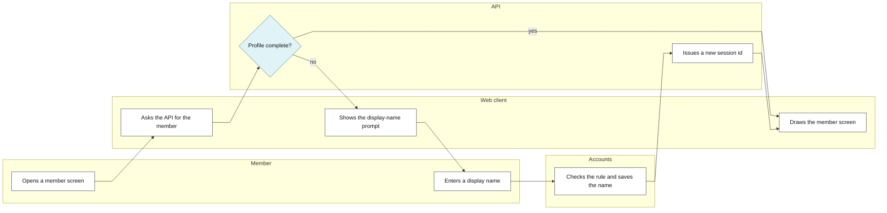

# Choose a display name

## Scope

This spec holds a signed-in member at the display-name prompt until they save a valid name, for
[PRD 0001](../../prd/0001-members-sign-up-sign-in-and-set-the-name-other-members-see.md) (member
accounts and display names), the PRD of [step 2](../../roadmap/roadmap.md#steps) (accounts and the
name others see). It builds on
[spec 0001](../0001-sign-in-to-the-portal-and-choose-a-display-name/0001-sign-in-to-the-portal-and-choose-a-display-name.md)
(sign in to the portal), called the sign-in spec below, for the session and its state-change
token, the request filter's first two checks, Accounts' profile table, and the Web client's API
client and member layout. It builds the display-name hold of the
[account pages](../../arch/08-crosscutting-concepts/authentication-and-authorisation.md#account-pages)
concept and the display name of the Profile class in
[data classification](../../arch/08-crosscutting-concepts/data-classification.md), which the
running system does not carry yet; the
[architecture leg's record](../../arch/_runs/0001-members-sign-up-sign-in-and-set-the-name-other-members-see.md#escalations)
(the decision to build them with this PRD's specs) holds why.

In scope:

- The display-name rule and the operation that sets a name, in Accounts.
- `PUT /api/members/me/display-name`, the request filter's third check, and the new session id
  issued when a profile becomes complete, in the API block.
- The display-name prompt and the API client's answer to `registration-incomplete`, in the Web
  client.

Out of scope:

- Sign-in, the session, the profile table and the member id: the sign-in spec.
- Changing the name on Your account, and the header's Sign out:
  [spec 0003](../0003-change-the-display-name-and-sign-out/0003-change-the-display-name-and-sign-out.md)
  (change the display name and sign out), which saves through this spec's route.
- Your account's content and the name in the header:
  [spec 0004](../0004-your-account-and-the-member-id/0004-your-account-and-the-member-id.md)
  (your account and the member id).
- Showing a display name to other members, which the PRD's
  [out of scope](../../prd/0001-members-sign-up-sign-in-and-set-the-name-other-members-see.md#out-of-scope)
  leaves to later steps.

## Approach

The request filter gains a third check that asks Accounts whether the member's profile is
complete, and answers `registration-incomplete` on every route outside the display-name setup
while it is not. The Web client opens the prompt on that answer. The prompt sends the name to one
route; Accounts checks it against the rule and saves it at the version it read, and the API block
then issues a new session id, because the member's profile is now complete. From then on every
request passes the filter.

The work lands in three blocks of the [building block view](../../arch/05-building-block-view.md).
[Accounts](../../arch/05-building-block-view.md#accounts) takes the rule and the operation that sets
a name, the [API](../../arch/05-building-block-view.md#api) takes the route, the filter's third
check and the mapping of two errors, and the
[Web client](../../arch/05-building-block-view.md#web-client) takes the prompt. The save follows the version rule of the
[persistence](../../arch/08-crosscutting-concepts/persistence.md) concept, and its errors reach the
member as the [error handling](../../arch/08-crosscutting-concepts/error-handling.md) concept maps
them.

### The display-name rule

Accounts refuses a value holding a line break anywhere, being U+000A, U+000B, U+000C, U+000D,
U+0085, U+2028 or U+2029. It then trims Unicode whitespace at both ends, normalises the rest to
NFC, and accepts 2 to 40 visible characters of any script, counted as Unicode extended grapheme
clusters with the `regex` library's `\X` pattern, so a character built from several code points,
the conjunct "ক্ষ" or a flag, counts once. It stores the trimmed, normalised value and never
checks it against other members' names. An invalid value raises `InvalidDisplayName`, which the
API block's handler answers as a 422 problem response listing `displayName` with the message
"Use 2 to 40 characters, on one line." The request model accepts a `displayName` string of at most
200 characters with no U+0000, which PostgreSQL cannot store, and refuses anything else with the
same 422.

### Setting the name

Accounts' interface gains a third operation beside the two the sign-in spec's
[profile and member id](../0001-sign-in-to-the-portal-and-choose-a-display-name/0001-sign-in-to-the-portal-and-choose-a-display-name.md#profile-and-member-id)
section builds: set the display name of a subject, giving the member or a typed error. It reads
the profile and updates it only at the version it read, raising the version by one. When another
write came first, Accounts raises `ProfileChanged`, which the API block's handler answers as a 409
problem response of type `profile-changed`, and nothing is saved.

`PUT /api/members/me/display-name` takes `displayName` and answers the body of the sign-in spec's
`GET /api/members/me`. The save that completes a profile is a change of privilege under the
[sign-in](../../arch/08-crosscutting-concepts/authentication-and-authorisation.md#sign-in)
concept: the API block issues a new session id for it, moves the session's row to the new id's
hash and keeps the state-change token. A save on a profile already complete keeps the session id.

### The request filter's third check

The sign-in spec's
[request filter](../0001-sign-in-to-the-portal-and-choose-a-display-name/0001-sign-in-to-the-portal-and-choose-a-display-name.md#the-request-filter)
runs two checks. This spec adds a third after them: a profile Accounts reports incomplete, on a
route outside the display-name setup, gets 403 of type `registration-incomplete`. The setup is
`GET /api/session` and `PUT /api/members/me/display-name`; sign-out joins it with the spec that
builds sign-out. `GET /api/members/me` is outside the setup, so the member layout's first read is
what meets the check.

### The prompt

The API client of the sign-in spec's
[Web client](../0001-sign-in-to-the-portal-and-choose-a-display-name/0001-sign-in-to-the-portal-and-choose-a-display-name.md#the-web-client)
opens the prompt on `registration-incomplete`, from any call. The prompt is drawn over the dimmed
member layout as
[SCR-3](../../ui/0001-members-sign-up-sign-in-and-set-the-name-other-members-see/screens.md#scr-3-choose-your-display-name)
(the prompt a member cannot get past) lays it out, and ignores Escape. Save display name sends the
field's value through the API client. A 422 draws the validation state with the problem's message;
a 200 closes the prompt, and the layout reads `GET /api/members/me` again and draws the screen.
Vue's escaping shows the name; no template uses `v-html`.

### Failure paths

| Case | What the system does | What the member sees |
|---|---|---|
| A member with no display name opens a member screen | 403 `registration-incomplete` on every route outside the setup | the prompt over the dimmed layout |
| A name outside the rule, or a value the request model refuses | 422, nothing saved | the prompt's validation state |
| Another write to the profile between the save's read and its update | 409 `profile-changed`, nothing saved | the prompt still open, with the API client's readable message and correlation id; no state of SCR-3 draws it |
| The session ended while the prompt was open | 401 from the filter | the provider's sign-in page, then the prompt again |
| A save without the state-change token, or from another origin | 403 `state-token-invalid`, nothing saved | the prompt still open, with the readable message and correlation id |

No log line carries a display name a member typed.

### Tests and local stand-ins

- Unit, pytest with no database: the display-name rule at 1, 2, 40 and 41 visible characters, each
  line break, trimming, a decomposed accent, "ক্ষ" and a flag each counted once, "Мария" and
  "李明"; the set operation's two typed errors with the profile repository faked. Through FastAPI's
  test client, with Accounts and the session store faked as the sign-in spec's
  [tests](../0001-sign-in-to-the-portal-and-choose-a-display-name/0001-sign-in-to-the-portal-and-choose-a-display-name.md#tests-and-local-stand-ins)
  fake them: the third check on and off the setup, the 422 and 409 mappings, and a new session id
  at the save that completes a profile and none at a later save. Vitest: the API client opening
  the prompt on `registration-incomplete`, the prompt's two states, and a 409 leaving it open with
  the readable message.
- Integration, in the sign-in spec's integration suite against the compose stack's PostgreSQL: a
  save at a stale version refused, and the stored value trimmed and normalised.
- Functional, stage 05's, on the stack and test members the sign-in spec's tests name: a test
  member's first sign-in ends at the prompt.

One thing is risky: the `regex` library counts grapheme clusters by the Unicode version it ships
with, so a name using characters newer than that version can count differently from what the
member's browser shows.

### Rollout

No flag: this spec goes out in one release with the sign-in spec, whose revision already creates
the profile with its display name and version, so this spec adds no migration. `regex` becomes a
runtime dependency. A rollback runs the previous version, and the names already saved stay.

## Acceptance criteria answered

### [Member accounts and display names](../../prd/0001-members-sign-up-sign-in-and-set-the-name-other-members-see.md)

The step's PRD: accounts, sign-in and the display name.

- [`AC-0001-6`](../../prd/0001-members-sign-up-sign-in-and-set-the-name-other-members-see.md#acceptance-criteria):
  "Given a member who has no display name, When any sign-in completes, Then they are asked for a
  display name, cannot dismiss the prompt, and cannot reach any other member screen until they set
  one." Answered in [The request filter's third check](#the-request-filters-third-check) and
  [The prompt](#the-prompt).
- [`AC-0001-7`](../../prd/0001-members-sign-up-sign-in-and-set-the-name-other-members-see.md#acceptance-criteria):
  "Given a member setting a display name, When they enter one of fewer than 2 or more than 40
  characters after trimming, or one with a line break, Then it is refused with a message stating
  the rule, and the name is not saved." Answered on the prompt in
  [The display-name rule](#the-display-name-rule) and [The prompt](#the-prompt); the change path
  on Your account is
  [spec 0003](../0003-change-the-display-name-and-sign-out/0003-change-the-display-name-and-sign-out.md#acceptance-criteria-answered)'s
  (change the display name and sign out).
- [`AC-0001-8`](../../prd/0001-members-sign-up-sign-in-and-set-the-name-other-members-see.md#acceptance-criteria):
  "Given a member setting a display name, When they enter one written in a non-Latin script, such
  as "Мария" or "李明", Then it is saved." Answered in [The display-name rule](#the-display-name-rule).

## Screens

- [`SCR-3`](../../ui/0001-members-sign-up-sign-in-and-set-the-name-other-members-see/screens.md#scr-3-choose-your-display-name):
  default and validation.

## Interfaces

[contracts/openapi.yaml](contracts/openapi.yaml)

## Data

No data change.

## Security

- **Browser to API.** No new boundary: the save is a state change behind the token and origin
  check the sign-in spec builds, which
  [who may do what](../../arch/08-crosscutting-concepts/authentication-and-authorisation.md#who-may-do-what)
  places. Refused: every route outside the setup while the profile is incomplete, which
  [AC-0001-6](../../prd/0001-members-sign-up-sign-in-and-set-the-name-other-members-see.md#acceptance-criteria)
  (the name prompt at sign-in) states; and a save that lacks the token or comes from another
  origin, which no criterion of the PRD covers, so the unit tests above prove its refusal.
- **Data.** The display name is the Profile class, held in Accounts alone, as
  [data classification](../../arch/08-crosscutting-concepts/data-classification.md) places it.
  Refused: a name outside the rule, and a value over 200 characters or holding U+0000, which
  [AC-0001-7](../../prd/0001-members-sign-up-sign-in-and-set-the-name-other-members-see.md#acceptance-criteria)
  (an invalid name refused) states.
- **Accepted gap.** The [input validation](../../arch/08-crosscutting-concepts/input-validation.md)
  concept bounds the rate of every form that writes per client, and this spec builds no limit on
  the save. A client holding a session can send saves at any rate, each a write to the profile.
