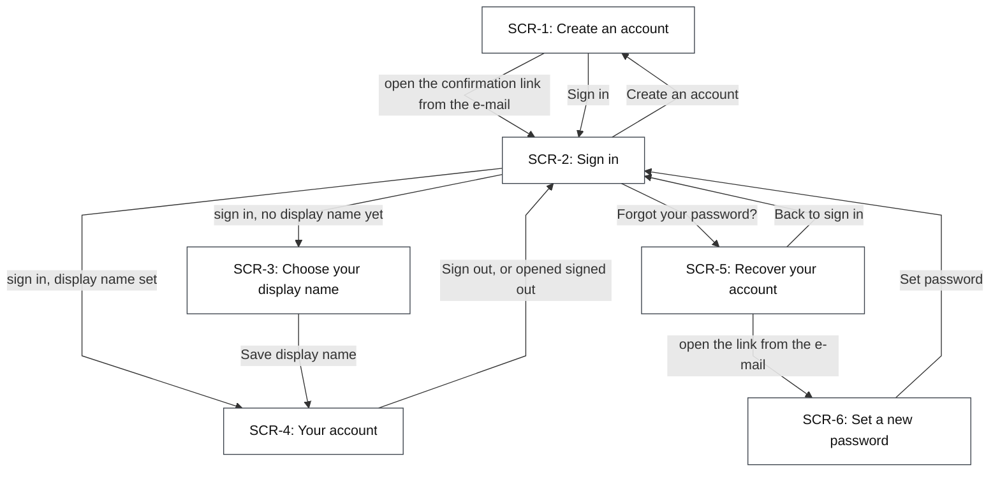

# Screens: Member accounts and display names

[Member accounts and display names](../../prd/0001-members-sign-up-sign-in-and-set-the-name-other-members-see.md),
the PRD these screens draw.

The project has no design system yet, so the pages are plain. Each page carries a bar along its foot
that switches between its states; the bar belongs to the prototype and not to the screen.

## Screens

### SCR-1: Create an account

- **Page:** [sign-up.html](sign-up.html)
- **States:**
  - default: the heading "Create an account", a line saying anyone can join, and the sign-up form.
  - success: the form is replaced by the heading "Confirm your e-mail address" and a line saying a
    link was sent to the address entered, to open before signing in, with a link to sign in. The
    same text shows whether or not the address already belongs to an account.
- **Layout:** one left-set column on the page, the wordmark at its top. Under it the heading, the
  line, then the form: E-mail address (required), then Password (required), then the primary
  action "Create account" across the column's width. Under the form, "Already have an account?"
  with a link to sign in.
- **Requirements:**
  - [R1 Sign-up](../../prd/0001-members-sign-up-sign-in-and-set-the-name-other-members-see.md#requirements),
    an account from an e-mail address and a password, open to anyone.
  - [R2 E-mail confirmation](../../prd/0001-members-sign-up-sign-in-and-set-the-name-other-members-see.md#requirements)
    and `AC-0001-1`, `AC-0001-3`: told to confirm, with one message for a new address and an
    address in use.

### SCR-2: Sign in

- **Page:** [sign-in.html](sign-in.html)
- **States:**
  - default: the heading "Sign in", a line, and the sign-in form.
  - error, wrong address or password: a red notice above the form, "The e-mail address or
    password is wrong", the same for either.
  - error, address not confirmed: a red notice above the form telling the holder to confirm the
    e-mail address first through the link sent at sign-up. Shown only after the right password.
  - success, address confirmed: a green notice above the form saying the address is confirmed and
    the holder can sign in.
  - success, new password set: a green notice above the form saying the new password is set.
- **Layout:** one left-set column, the wordmark at its top. Under it the heading, the line, the
  notice where the state has one, then the form: E-mail address (required), then Password
  (required) with the link "Forgot your password?" on the password label's line, at its right
  end, then the primary action "Sign in" across the column's width. Under the form, "New here?"
  with a link to create an account.
- **Requirements:**
  - [R3 Sign-in](../../prd/0001-members-sign-up-sign-in-and-set-the-name-other-members-see.md#requirements)
    and `AC-0001-2`, `AC-0001-4`, `AC-0001-5`: one message for a wrong address or password, and
    the confirm-first message only after the right password.
  - [R2 E-mail confirmation](../../prd/0001-members-sign-up-sign-in-and-set-the-name-other-members-see.md#requirements),
    where the confirmation link leads.
  - [R4 Sign-out](../../prd/0001-members-sign-up-sign-in-and-set-the-name-other-members-see.md#requirements)
    and `AC-0001-11`, `AC-0001-12`: where signing out, and opening a member screen signed out, lead.
  - [R8 Account recovery](../../prd/0001-members-sign-up-sign-in-and-set-the-name-other-members-see.md#requirements),
    where setting a new password leads.

### SCR-3: Choose your display name

- **Page:** [display-name.html](display-name.html)
- **States:**
  - default: the prompt over the dimmed member screen, with an empty Display name field.
  - validation: the field outlined in red with the message "Use 2 to 40 characters, on one line."
    under it; the name is not saved and the prompt stays.
- **Layout:** a prompt centred over the member screen, which shows dimmed behind it and cannot be
  used. The prompt has no close control and no sign-out, and the header behind it shows no
  sign-out either: a member who wants to leave closes the tab, and on returning sees the prompt
  again, after signing in first if the session has ended by then. In the prompt, top to bottom:
  the heading "Choose your display name", a line saying other members will see the name and it
  can be changed later, the field Display name (required) with the rule under it (2 to 40
  characters, any alphabet, others may share it, the member id tells them apart), and the primary
  action "Save display name" across the prompt's width.
- **Requirements:**
  - [R5 Display name](../../prd/0001-members-sign-up-sign-in-and-set-the-name-other-members-see.md#requirements)
    and `AC-0001-6`, `AC-0001-7`, `AC-0001-8`, `AC-0001-9`: a prompt that cannot be dismissed, at
    every sign-in until a name is set, and the name's rules.

### SCR-4: Your account

- **Page:** [account.html](account.html)
- **States:**
  - default: the member's display name in the header, and the Display name field filled with it.
  - validation: the field outlined in red with the message "Use 2 to 40 characters, on one line."
    under it; the name is not saved.
  - success: a green notice "Display name saved." under the heading, and the new name in the
    header and in the field.
- **Layout:** a header bar across the top with the wordmark at its left and, at its right, the
  member's display name followed by the link "Sign out". Under it, the heading "Your account" and
  a line, then two sections one above the other, each under a thin rule. Display name: the rule
  for a name, then the field Display name (required) with the primary action "Save display name"
  at its right; on a phone the action sits under the field. Member id: the member's id shown
  boxed, and a line saying other members can see it and it tells apart members who share a
  display name.
- **Requirements:**
  - [R6 Changing the display name](../../prd/0001-members-sign-up-sign-in-and-set-the-name-other-members-see.md#requirements)
    and `AC-0001-7`, `AC-0001-10`: change under the same rules, the new name replacing the old.
  - [R7 Where the name shows](../../prd/0001-members-sign-up-sign-in-and-set-the-name-other-members-see.md#requirements)
    and `AC-0001-13`: the display name on the member's own screens.
  - [R9 Member id](../../prd/0001-members-sign-up-sign-in-and-set-the-name-other-members-see.md#requirements)
    and `AC-0001-9`: the member id, with no part of the e-mail address in it.
  - [R4 Sign-out](../../prd/0001-members-sign-up-sign-in-and-set-the-name-other-members-see.md#requirements)
    and `AC-0001-11`, `AC-0001-12`: signing out from the header, and a signed-out visitor sent to
    sign in.

### SCR-5: Recover your account

- **Page:** [recover.html](recover.html)
- **States:**
  - default: the heading "Recover your account", a line, and the form.
  - success: the form is replaced by the heading "Check your e-mail" and a line saying that if the
    address belongs to an account, a link to set a new password is on its way. The same text
    shows for any address.
- **Layout:** one left-set column, the wordmark at its top. Under it the heading, the line, then
  the form: E-mail address (required), then the primary action "Send link" across the column's
  width. Under it, in both states, a link back to sign in.
- **Requirements:**
  - [R8 Account recovery](../../prd/0001-members-sign-up-sign-in-and-set-the-name-other-members-see.md#requirements)
    and `AC-0001-14`: a link to the confirmed address, and one message for any address.

### SCR-6: Set a new password

- **Page:** [new-password.html](new-password.html)
- **States:**
  - default: the heading "Set a new password", a line, and the form.
- **Layout:** one left-set column, the wordmark at its top. Under it the heading, the line, then
  the form: New password (required), then the primary action "Set password" across the column's
  width.
- **Requirements:**
  - [R8 Account recovery](../../prd/0001-members-sign-up-sign-in-and-set-the-name-other-members-see.md#requirements)
    and `AC-0001-14`: setting a new password from the link, then signing in with it.

## Flow

